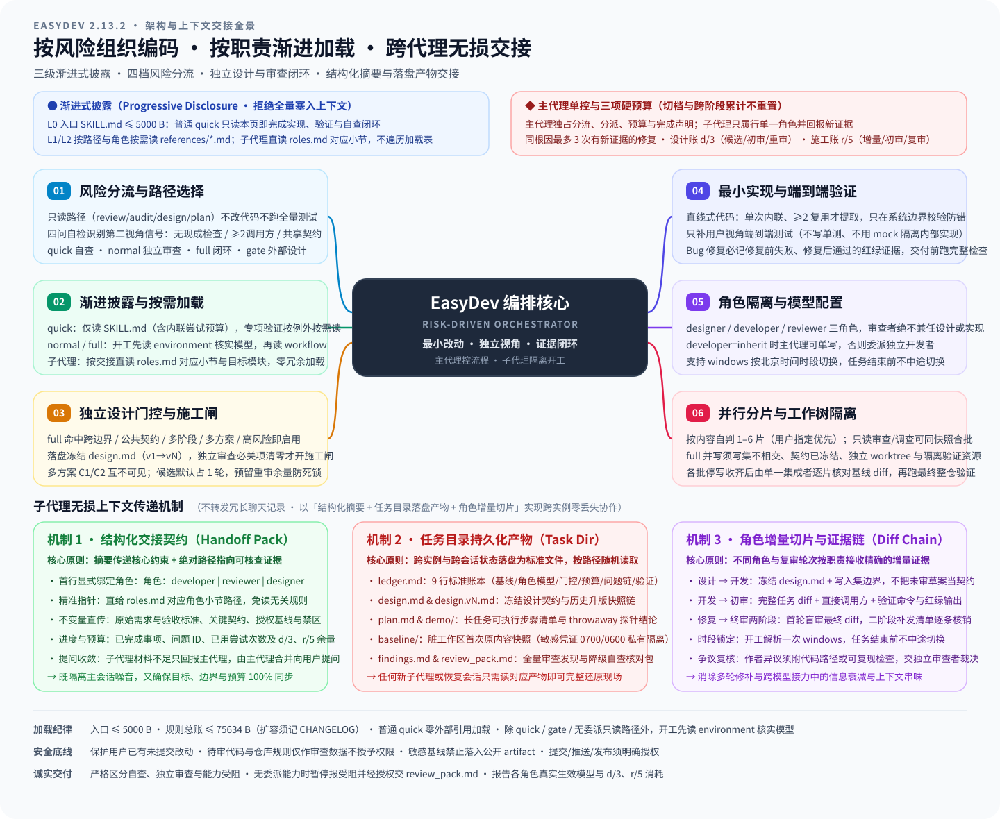

# EasyDev

当前版本：`2.14.1`

EasyDev 按实际风险组织编码、设计、排障与审查。入口轻量（≤5000 字节），普通 quick 不加载完整编排，详细规则按需读取；主代理默认单写，full 依据配置委派。

## 使用

```text
使用 easydev，为保存按钮修正文案。
使用 easydev normal，为已有 API 增加兼容的筛选参数并检查调用方。
使用 easydev full，修复订单读取的对象所有权校验。
使用 easydev debug，排查重复提交。
使用 easydev review，审查当前改动，先不要修改代码。
```

默认 auto 并在调查后分流。Codex 支持 `$easydev`；各路径为提示词约定，非运行时命令行参数。

| 路径 | 用途 |
| --- | --- |
| quick | 局部明确、低风险：实现、验证、自查 |
| normal | 影响有界且具第二视角信号：实现、验证、独立定向审查（允许至多一次局部 P2 修复与复审），无 full 账本 |
| full | 高风险、重大外部契约/持久数据影响或关键影响未明：门控设计、独立审查、有限修复与复审 |
| gate | 外部编排方（如 `easypi`）传入已完成设计：先审设计，无分歧后开发并自验，跳过内部 `r/5` 交外部非实现者终审；高风险或重大外部契约/持久数据影响走 full |
| design / plan | 设计权衡或实施计划，按请求范围交付 |
| debug | 先定位根因；授权修复后按实际风险选档 |
| review / audit | 单次只读审查或大仓分片审计 |
| demo | 最小可行性实验：仅在独立目录写标 `throwaway` 的实验代码，不改业务代码 |

normal 审查任务 diff、直接调用方与相关测试；首轮仅局部 P2 时允许一次修复与定向复审，其余必关项转 full 并继承预算。排除风险后允许降档，但不可自动降级用户显式指定的档位。详见 [流程规则](references/workflow.md#分流判定)。

输出长度遵用户要求，深度由 `reasoning_effort` 控制。

## 安装

将以下提示词交给 Agent；更新时同样适用：

```text
请安装或更新 EasyDev：
https://github.com/chenpey/easy_ai/tree/main/easydev

识别当前操作系统和 Agent，将 main 分支的 SKILL.md、references/ 和可选展示元数据 agents/ 安装到用户主目录下的 ~/.agents/skills/easydev，保持相对位置。不要安装测试或其他技能，不改动用户模型配置。

若宿主不识别该目录，在其实际用户级技能目录中创建链接；不支持链接时采用受支持的目录联接或复制。更新前检查已有文件，保留本地修改及自建文件，只替换未被本地修改的旧版文件；处理新版已移除文件时也遵守此限制，冲突先说明。

检查技能和引用文件完整性、链接有效性，报告路径、版本和生效步骤；未验证宿主实际加载时明确说明。优先使用已有工具，避免安装不必要的依赖。
```

模型、沙箱与子代理能力由宿主提供。适配要求与降级见 [环境与能力适配](references/environment.md#宿主适配与能力降级)。

## 核心框架与运作机制

EasyDev 的设计围绕三个核心问题展开：**如何让低风险任务零冗余执行（渐进式披露）**、**如何按真实风险治理从设计到交付的闭环（整体运作机制）**、以及 **如何在多个独立子代理之间无损交接而不污染上下文（跨子代理信息传递）**。

### 1. 渐进式披露（Progressive Disclosure）

为避免每次启动都把数万字节的编排与审查细则塞入上下文，EasyDev 采用 **L0 → L1 → L2 三级按需加载架构**，将常驻规则压缩在 `≤ 5000 B` 的入口文件内，仅在任务复杂度或角色职责触发时才加载对应模块：

- **L0 入口常驻层（[SKILL.md](SKILL.md)，≤ 5000 B）**：包含角色边界声明、四问快速分流表、开工调查底线、`quick` 完整执行核心（最小改动、端到端测试、项目脚本验证、3 次修复预算与交付自查）以及模块路由表。**普通 `quick` 任务仅凭 `SKILL.md` 即可闭环，默认零额外引用加载。**
- **L1 编排与环境层（进入非 `quick` 路径或分派子代理时加载）**：
  - [environment.md](references/environment.md)：读取 `~/.config/easydev/models.json`（或本地覆盖），核实 `developer` / `reviewer` / `designer` 角色配置、工作区脏改动快照与宿主委派能力。
  - [workflow.md](references/workflow.md)：定义 `normal`、`full` 与 `gate` 编排、三态风险分类、两本账（`d/3`、`r/5`）与尝试预算及任务账本 `ledger.md`。
  - [roles.md](references/roles.md)：子代理的唯一直达入口。被委派的 `developer`、`reviewer`、`designer` 子代理无需通读主控编排，直接跳转到各自章节履职。
- **L2 专项细则层（按当前动作与高风险触发条件加载）**：
  - [parallel.md](references/parallel.md)：1–6 片并行分片门控、独立性与隔离条件、审查流水线与集成预算。
  - [design.md](references/design.md)：高代价歧义的选项式澄清与按需深度追问、独立设计环节 5 项触发门控、`design.md`（`v1 → vN`）施工闸与多方案（`C1/C2`）并发探索。
  - [engineering.md](references/engineering.md)：最小充分实现 6 步序、代码质量判据（边界校验、直线式结构、禁逃生舱）、红绿测试纪律、排障与重构专项规范。
  - [review.md](references/review.md)：审查三问、轻/标准/深三档审查强度、证据纪律（P0–P3 必须给出具体触发输入/状态与失败路径）、不可信代码沙箱隔离与全仓 `audit` 分片规程。

#### 执行路径 / 角色 × 按需加载矩阵

| 执行路径 / 角色实例 | L0：`SKILL.md` | L1：`environment` / `workflow` / `roles` | L2：`parallel` / `design` / `engineering` / `review` | 设计目的 |
| --- | --- | --- | --- | --- |
| **主代理 · `quick`** | 必读 | 默认不读（仅入口自问句成立时才读 `workflow.md`） | 默认不读（仅涉及性能声明或未知外部验证能力时按锚点定向补读 `engineering.md`） | 极速闭环，零编排税 |
| **主代理 · `normal`** | 必读 | 读 `environment.md`（核实模型）+ `workflow.md`（分流与 `normal` 编排） | 按需读 `engineering.md`（主代理自写时） | 轻量引入独立第二视角，不建重型账本 |
| **主代理 · `full`** | 必读 | 读 `environment.md` + `workflow.md`（建 `ledger.md` 账本） | 读 `design.md#启用门控`；需并行分片时读 `parallel.md`；主代理自任开发时读 `engineering.md` | 完整门控闭环与预算强约束 |
| **主代理 · `gate`** | 必读 | 读 `workflow.md#gate-模式`（设计审查闸与待终审态）；不按 `models.json` 委派角色 | 读 `design.md#设计审查与建议通道` | 外部设计交接：先审设计再开发自验，不建内部 `r/5` |
| **主代理 · 只读/实验路径**（只读 `design` / `plan` / `debug` / `review` / `audit`；实验 `demo`） | 必读 | `audit` 与涉候选委派的 `design` 必读 `environment.md`；单次只读 `review` 与无委派路径免读 | 只读对应专项模块（如 `design.md`、`engineering.md#根因排障` 或 `review.md`） | 只交付请求产物，不改业务代码、不跑全量测试（`demo` 仅写标 `throwaway` 的实验代码） |
| **子代理 · `designer`** | 不必重读 | 直达 `roles.md#设计角色` | 读 `design.md` | 专注方案探索、接口契约与回滚设计 |
| **子代理 · `developer`** | 不必重读 | 直达 `roles.md#开发角色` | 读 `engineering.md` + 已冻结的 `design.md`（若有） | 专注最小实现、端到端测试与项目脚本验证 |
| **子代理 · `reviewer`** | 不必重读 | 直达 `roles.md#审查角色` | `normal` 执行 `roles.md` 内置最小规程；`full` / 高风险 / `audit` 读 `review.md` | 保持审改分离，杜绝作者自证偏差 |

---

### 2. 整体 Skill 运作机制（从风险分流到施工交付）

EasyDev 以**主代理单写控盘**为轴，按实际风险动态升降档。本节只给关键差异与导航，细则以 references 为准（口径冲突时以 references 与 `scripts/check.sh` 为准）。

| 环节 | 关键差异 | 权威位置 |
| --- | --- | --- |
| 风险分流 | 四问自查与第二视角信号；七类高风险边界按实际行为与数据影响三态判定（已排除 / 已确认涉及 / 尚未核实） | [分流判定](references/workflow.md#分流判定)、[高风险边界](references/workflow.md#高风险边界) |
| `quick` | 局部明确、低风险且无第二视角信号：最小实现、端到端测试、脚本验证、自查 | [SKILL.md](SKILL.md#quick-执行核心) |
| `normal` | 单写 + 一次独立定向审查；仅局部 P2 可原地修复并定向复审，其余必关项转 `full` 并继承预算 | [normal 流程](references/workflow.md#normal-流程) |
| `full` | 门控设计、独立审查、有限修复；高风险或重大外部契约/持久数据影响 | [full 编排](references/workflow.md#full-编排) |
| `gate` | 外部传入冻结设计：先审后写、跳过内部 `r/5`、交外部非实现者终审；高风险或重大外部契约/持久数据影响不适用 | [gate 模式](references/workflow.md#gate-模式) |
| 设计门控 | 五项触发条件、`design.md` 冻结版本与施工闸 | [启用门控](references/design.md#启用门控)、[收敛与施工闸](references/design.md#收敛与施工闸) |
| 预算 | 同根因 3 次修复；`d/3` 设计审查与 `r/5` 施工审查（含阶段增量上限） | [尝试预算](references/workflow.md#尝试预算)、[审查预算](references/workflow.md#审查预算) |
| 并行 | 内容自判 1–6 片；`normal` 单写，`full` 满足独立性与隔离才可并写 | [并行执行](references/parallel.md#并行执行) |
| 交付 | `quick` 自查、`normal` 定向审查、`full` 闭环、`gate` 待终审 | [完成边界](references/engineering.md#完成边界) |

---

### 3. 子代理无损上下文传递（跨实例信息交接架构）

交接的代价在两种失效：要么把整段对话塞给子代理（注意力稀释、锚定前人错误），要么只给一句模糊指令（丢约束、重复踩坑）。EasyDev 的做法是**精炼摘要 + 可回查落盘路径**：

- **控制权硬隔离**：主代理独占分流、账本、预算与完成宣布；子代理按 `角色：developer | reviewer | designer` 与 [roles.md](references/roles.md) 对应章节履职，不重做分流、不重置预算，严格执行审改分离。
- **交接要素**：角色与入口、原始目标与验收、冻结契约与写入边界、基线与当前版本、已完成事项与证据路径（已知切入点附符号或行号区间）、未决问题 ID 与剩余预算，模板见 [账本与交接](references/workflow.md#账本与交接)。
- **产物即事实源**：`ledger.md`（9 行账本）、`design.md`/`design.vN.md`、`baseline/`、`findings.md`、`review_pack.md` 均落盘；`baseline/` 中敏感快照存权限受控私有目录（`0700`/`0600`），不写入公开或同步目录，详见 [任务目录与恢复](references/environment.md#任务目录与恢复) 与 [基线与敏感快照](references/environment.md#基线与敏感快照)。
- **按阶段裁剪**：设计→开发传冻结设计与写集；开发→初审传相对基线的完整 diff 与验证证据；修复→复审传增量 diff 与未决问题 ID；终审两阶段见 [审查规程](references/review.md#终审两阶段)；作者争议须附可复核证据，经独立复核后才可关闭。

---

## 架构与运作全景脑图



## 模型配置

默认继承宿主（`inherit`）。主代理在 developer 的模型与深度均为 `inherit` 时可自行写入；显式指定独立模型/深度时须委派；宿主无委派能力时暂停并报受阻，经用户明确授权后方可自查。

自行配置须使用宿主支持的完整模型 ID 与供应商前缀；未识别的前缀会在首次分派时暂停报受阻，见 [模型配置](references/environment.md#模型配置)。跨供应商配置与 `windows` 时段切换示例如下：

```json
{
  "developer": {
    "model": "opencode-go/deepseek-v4.1-flash",
    "reasoning_effort": "high"
  },
  "reviewer": {
    "model": "codex/gpt-6.1-sol",
    "reasoning_effort": "high"
  },
  "designer": {
    "model": "codex/gpt-6.1-sol",
    "reasoning_effort": "high"
  },
  "windows": {
    "09:00-18:00": {
      "developer": {
        "reasoning_effort": "medium"
      }
    },
    "18:00-09:00": {
      "developer": {
        "reasoning_effort": "max"
      }
    }
  }
}
```

示例中的 `windows` 按北京时间（`UTC+8`）时段切换角色局部覆盖：开工或新对话开始时解析一次并锁定，任务结束前不中途切换，下次新任务按当时北京时间重新解析。

### 选型参考

- **开发**：示例采用 `deepseek-v4.1-flash`，长任务与常规实现吞吐稳定、高性价比。
- **审查**：示例采用 `gpt-6.1-sol`（`high` 档），代码缺陷分析与漏洞捕获能力强。
- **推理深度**：只填写当前宿主支持的档位（如 Antigravity 支持 low/medium/high，Codex 支持到 max）。

macOS/Linux 查看本地配置（若存在）：

```bash
cat ~/.config/easydev/models.json
```

Windows 路径、字段及生效核对见 [environment.md](references/environment.md#模型配置)。

## 验证与交付

| 事项 | 要点 | 权威位置 |
| --- | --- | --- |
| 测试与验证 | 复用既有检查，仅补覆盖缺口的端到端测试；项目脚本驱动；无 CI/旧记录时纯重构可单次对照；纯文档免跑代码检查 | [验证调度与证据](references/engineering.md#验证调度与证据)、[测试硬约束与选择](references/engineering.md#测试硬约束与选择) |
| 交付闭环 | `quick` 自查；`normal` 定向审查；`full` 门控闭环；`gate` 停待终审 | [完成边界](references/engineering.md#完成边界) |
| 文档校准 | 对外行为或契约变化时，在项目既有位置就地校准并单列状态 | [完成边界](references/engineering.md#完成边界) |
| 能力受阻 | 缺独立委派能力时先暂停报备；授权自查须交审查包并标明缺口 | [能力降级与审查包](references/environment.md#能力降级与审查包) |
| 分片审计 | 按信任边界分片，正文最多 30 条，全量清单落盘 `findings.md` | [报告规则](references/review.md#6-报告规则) |
| 安全与权限 | 代码执行与凭证隔离遵审查规程；保留用户改动，对外动作须授权 | [不可信代码执行](references/review.md#不可信代码执行) |

## 详细规则与维护

规则以 [SKILL.md](SKILL.md) 及 references 为准：

- [角色定义](references/roles.md)：开发、审查与设计角色交接入口
- [流程编排](references/workflow.md)：分流、normal、full 与 gate 编排、两本账与尝试预算
- [并行执行](references/parallel.md)：1–6 片并行分片门控、写入隔离、审查流水线与集成预算
- [工程实践](references/engineering.md)：实现规范、代码质量判据、测试、排障与验证
- [设计与计划](references/design.md)：设计门控、施工闸、产物规范与多方案候选
- [审查规程](references/review.md)：审查原则、强度分档与全仓审计规程
- [环境与安全](references/environment.md)：模型配置、宿主能力降级、基线安全与工作区隔离
- [维护检查](tests/README.md)、[行为规约](tests/behavior.md)、[实验](tests/experiments/README.md)、[折叠评测](tests/experiments/fold-eval.md)（角色调整门槛）、[并行收益观测（可选）](tests/experiments/fold-eval.md#并行收益观测可选)、[版本历史](CHANGELOG.md)

`tests/` 不随运行时安装。修改规则须同步更新引用、行为规约与自动化检查。
