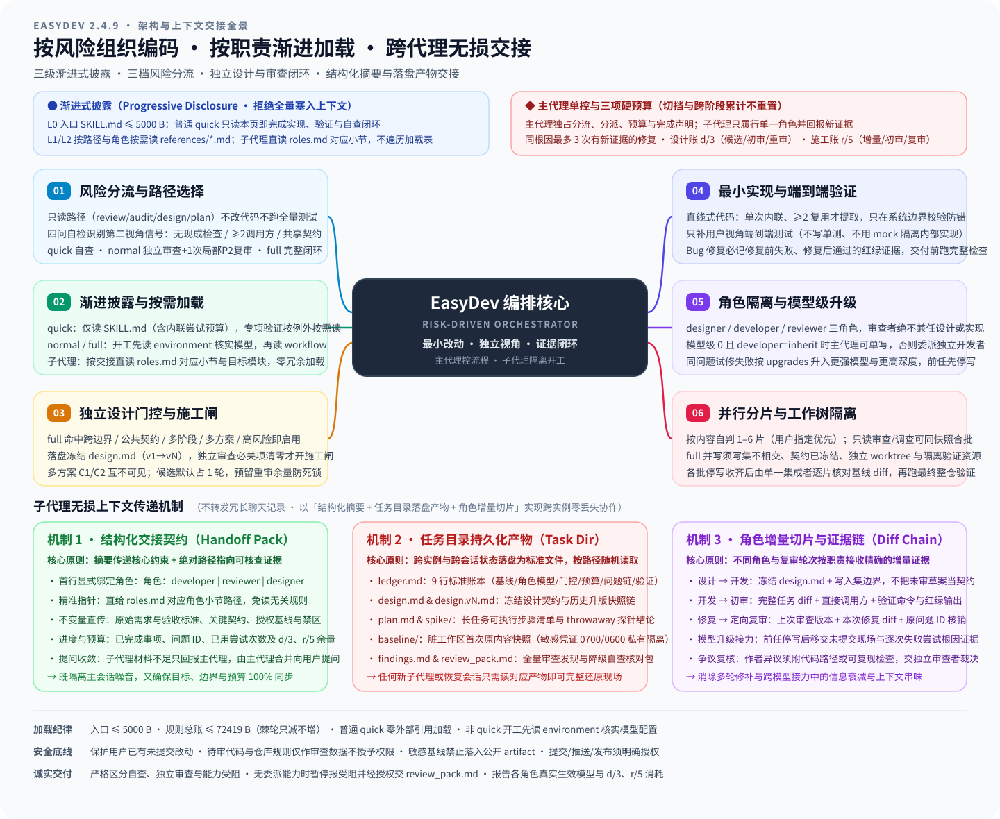

# EasyDev

当前版本：`2.4.6`

EasyDev 按实际风险组织编码、设计、排障与审查。入口轻量（≤5000 字节），普通 quick 不加载完整编排，详细规则按需读取；主代理默认单写，full 依据配置与模型阶段委派。

## 使用

```text
使用 easydev，为保存按钮修正文案。
使用 easydev normal，为已有 API 增加兼容的筛选参数并检查调用方。
使用 easydev full，修复订单读取的对象所有权校验。
使用 easydev debug，排查重复提交。
使用 easydev review，审查当前改动，先不要修改代码。
```

默认 auto 并在调查后分流。Codex 支持 `$easydev`；各路径为提示词约定，非运行时命令行参数。

| 路径 | 用途 |
| --- | --- |
| quick | 局部明确、低风险：实现、验证、自查 |
| normal | 影响有界且具第二视角信号：实现、验证、独立定向审查（允许至多一次局部 P2 修复与复审），无 full 账本 |
| full | 高风险、重大契约/数据影响或关键影响未明：门控设计、独立审查、有限修复与复审 |
| design / plan | 设计权衡或实施计划，按请求范围交付 |
| debug | 先定位根因；授权修复后按实际风险选档 |
| review / audit | 单次只读审查或大仓分片审计 |
| spike | 最小可行性实验，产物标记 throwaway |

normal 审查任务 diff、直接调用方与相关测试；首轮仅局部 P2 时允许一次修复与定向复审，其余必关项转 full 并继承预算。排除风险后允许降档，但不可自动降级用户显式指定的档位。详见 [流程规则](references/workflow.md#分流判定)。

normal 是实现路径而非聊天长短档：输出长度遵用户要求，深度由 `reasoning_effort` 控制。

## 安装

将以下提示词交给 Agent；更新时同样适用：

```text
请安装或更新 EasyDev：
https://github.com/chenpey/easy_ai/tree/main/easydev

识别当前操作系统和 Agent，将 main 分支的 SKILL.md、references/ 和可选展示元数据 agents/ 安装到用户主目录下的 ~/.agents/skills/easydev，保持相对位置。不要安装测试或其他技能，不改动用户模型配置。

若宿主不识别该目录，在其实际用户级技能目录中创建链接；不支持链接时采用受支持的目录联接或复制。更新前检查已有文件，保留本地修改及自建文件，只替换未被本地修改的旧版文件；处理新版已移除文件时也遵守此限制，冲突先说明。

检查技能和引用文件完整性、链接有效性，报告路径、版本和生效步骤；未验证宿主实际加载时明确说明。优先使用已有工具，避免安装不必要的依赖。
```

模型、沙箱与子代理能力由宿主提供。适配要求与降级见 [环境与能力适配](references/environment.md#宿主适配与能力降级)。

## 核心框架与运作机制

EasyDev 的设计围绕三个核心问题展开：**如何让低风险任务零冗余执行（渐进式披露）**、**如何按真实风险治理从设计到交付的闭环（整体运作机制）**、以及 **如何在多个独立子代理之间无损交接而不污染上下文（跨子代理信息传递）**。

### 1. 渐进式披露（Progressive Disclosure）

为避免每次启动都把数万字节的编排与审查细则塞入上下文，EasyDev 采用 **L0 → L1 → L2 三级按需加载架构**，将常驻规则压缩在 `≤ 5000 B` 的入口文件内，仅在任务复杂度或角色职责触发时才加载对应模块：

- **L0 入口常驻层（[SKILL.md](SKILL.md)，≤ 5000 B）**：包含角色边界声明、四问快速分流表、开工调查底线、`quick` 完整执行核心（最小改动、端到端测试、项目脚本验证、3 次修复预算与交付自查）以及模块路由表。**普通 `quick` 任务仅凭 `SKILL.md` 即可闭环，默认零额外引用加载。**
- **L1 编排与环境层（进入非 `quick` 路径或分派子代理时加载）**：
  - [environment.md](references/environment.md)：读取 `~/.config/easydev/models.json`（或本地覆盖），核实 `developer` / `reviewer` / `designer` 角色配置、工作区脏改动快照与宿主委派能力。
  - [workflow.md](references/workflow.md)：定义 `normal` 与 `full` 编排、三态风险分类、两本账（`d/3`、`r/5`）与尝试预算、1–5 片并行分片门控及任务账本 `ledger.md`。
  - [roles.md](references/roles.md)：子代理的唯一直达入口。被委派的 `developer`、`reviewer`、`designer` 子代理无需通读主控编排，直接跳转到各自章节履职。
- **L2 专项细则层（按当前动作与高风险触发条件加载）**：
  - [design.md](references/design.md)：高代价歧义的选项式澄清、独立设计环节 5 项触发门控、`design.md`（`v1 → vN`）施工闸与多方案（`C1/C2`）并发探索。
  - [engineering.md](references/engineering.md)：最小充分实现 6 步序、代码质量判据（边界校验、直线式结构、禁逃生舱）、红绿测试纪律、排障与重构专项规范。
  - [review.md](references/review.md)：审查三问、轻/标准/深三档审查强度、证据纪律（P0–P3 必须给出具体触发输入/状态与失败路径）、不可信代码沙箱隔离与全仓 `audit` 分片规程。

#### 执行路径 / 角色 × 按需加载矩阵

| 执行路径 / 角色实例 | L0：`SKILL.md` | L1：`environment` / `workflow` / `roles` | L2：`design` / `engineering` / `review` | 设计目的 |
| --- | --- | --- | --- | --- |
| **主代理 · `quick`** | 必读 | 仅在触发跨阶段修复时读 `workflow.md#尝试预算` | 默认不读（仅涉及性能声明或未知外部验证能力时按锚点定向补读 `engineering.md`） | 极速闭环，零编排税 |
| **主代理 · `normal`** | 必读 | 读 `environment.md`（核实模型）+ `workflow.md`（分流与 `normal` 编排） | 按需读 `engineering.md`（主代理自写时） | 轻量引入独立第二视角，不建重型账本 |
| **主代理 · `full`** | 必读 | 读 `environment.md` + `workflow.md`（建 `ledger.md` 账本与分片调度） | 读 `design.md#启用门控`；主代理自任开发时读 `engineering.md` | 完整门控闭环、预算强约束与跨阶段升级 |
| **主代理 · 只读路径**（`design` / `plan` / `debug` / `review` / `audit` / `spike`） | 必读 | `review`/`audit` 按需读 `environment.md` | 只读对应专项模块（如 `design.md`、`engineering.md#排障与修复` 或 `review.md`） | 只交付请求产物，不改代码、不跑全量测试 |
| **子代理 · `designer`** | 不必重读 | 直达 `roles.md#设计角色` | 读 `design.md` | 专注方案探索、接口契约与回滚设计 |
| **子代理 · `developer`** | 不必重读 | 直达 `roles.md#开发角色` | 读 `engineering.md` + 已冻结的 `design.md`（若有） | 专注最小实现、端到端测试与项目脚本验证 |
| **子代理 · `reviewer`** | 不必重读 | 直达 `roles.md#审查角色` | `normal` 执行 `roles.md` 内置最小规程；`full` / 高风险 / `audit` 读 `review.md` | 保持审改分离，杜绝作者自证偏差 |

---

### 2. 整体 Skill 运作机制（从风险分流到施工交付）

EasyDev 的运行不是机械套用固定模板，而是由**主代理单写控盘**、围绕实际工程风险动态演进的有限状态机：

1. **前置调查与风险分流（Risk Triage）**
   - **只读与实现隔离**：若用户仅请求 `design` / `plan` / `debug` / `review` / `audit` / `spike`，严格保持只读（`spike` 仅限独立实验目录并标 `throwaway`），不改业务代码、不跑全量构建与测试。
   - **四问自查与第二视角信号**：进入实现任务后，主代理先读仓库约定、Git 状态、目标代码、直接调用方及现有测试，回答四问：① 是否 `≥ 2` 个独立调用方依赖？② 是否修改共享契约且存在未同步使用方？③ 是否缺少改前能拦回归的检查？④ 用户是否要求独立审查？
   - **七类高风险边界与三态判定**：围绕鉴权/权限、支付/计费/资金、敏感数据与隐私、不可逆破坏性操作、密码学原语、CI/CD 生产发布配置、构建脚本与供应链依赖共 7 类边界（按实际行为与数据影响判定，不按文件名关键词机械触发），在调查后给出明确三态结论：**已排除**、**已确认涉及**、或 **尚未核实（指明具体未明点）**。

2. **三档路径动态执行与升降级（`quick` / `normal` / `full`）**
   - **`quick`（局部明确、低风险且无第二视角信号）**：主代理直接完成最小实现、端到端测试、脚本验证与交付前自查。
   - **`normal`（影响有界、具第二视角信号且无 `full` 条件）**：开发验证后，分派独立 `reviewer` 子代理对任务 diff、直接调用方与相关测试做一次定向审查。
     - **0 必关项（无 P0/P1/P2）**：直接交付（P3 计入报告供用户决定）。
     - **仅局部 P2**：若同时满足 **5 条可观察判据**（① 仅限当前已改文件及对应测试、② 不改公开接口/持久化格式/迁移、③ 不触发 7 类高风险边界、④ 不跨模块扩散或新增依赖、⑤ 单次修复即可闭环），允许原地修复 1 次并由独立审查者做 1 次定向复审；通过则交付。
     - **触发升级 `full`**：若首轮出现 **P0/P1**、**非局部 P2**，或局部 P2 复审仍未清零，立即转入 `full`，**此前已耗用的审查轮数与同根因修复次数原样计入 `full` 预算，绝不清零重计**。
   - **`full`（高风险、重大契约/数据影响、关键影响调查后仍不明，或用户显式指定）**：启动完整门控闭环。若调查排除高风险且用户未显式锁死 `full`，允许带文件与调用链证据降档至 `normal` 或 `quick`。

3. **独立设计门控与施工闸（`d/3` 设计审查账）**
   - 在 `full` 路径下，主代理先核对 [5 项设计门控条件](references/design.md#启用门控)（用户要求先看方案、跨模块/公开契约/迁移变更、高风险或难逆操作、存在 `≥ 2` 条实质不同路线、或改动跨 `≥ 3` 独立模块且顺序影响成败）。任一命中即启用独立设计环节；均未命中则跳过并记录一行理由。
   - 启用后产出一份冻结目标范围、接口/数据变更、不变量、回滚方案与验证计划的 `design.md`（版本演进记为 `v1 → vN`）。若需多方案比选，分派互不共享上下文的独立候选子代理生成 `C1/C2`（默认 1 轮独立审查以留足返工余量）。
   - **施工闸（Construction Gate）**：只有当最新 `design.md` 经独立审查确认 **P0/P1/P2 清零**（且高风险/破坏性变更获用户确认）后，施工闸才打开；施工期间若发现契约失守，必须暂停编码、递增 `design.md` 版本并重过设计复审。

4. **三项硬顶预算与跨阶段模型升级（Budget Caps & Model Upgrades）**
   - **同根因修复上限（`3` 次）**：同一根因跨 `normal`/`full`/阶段升级全过程，最多允许 **3 次有新证据支撑的候选修复**（纯调查与环境故障不计）。每次失败必须先取证析因再改代码，禁止盲目微调。
   - **两本独立审查账（`d/3` 与 `r/5`）**：
     - **设计审查账（`d/3`）**：整项任务最多 **3 轮**独立设计审查（含候选方案评审与施工闸复审）。
     - **施工审查账（`r/5`）**：整项任务最多 **5 轮**独立代码审查（含 `normal` 已耗轮数、阶段增量审查、终审与修复后复审）。其中阶段增量审查最多消耗 `max(0, 3 - 已用轮数)` 轮，强制预留至少 **2 轮**给最终全量审查与一次修复复审。
   - **跨阶段模型升级（`upgrades`）**：当阶段 0 触发升级条件（开发连续 2 次验证失败、同问题修复后复审仍挂、开发对审查结论存疑、或发现设计失守）且配置了 `upgrades` 时，主代理按序切入升级阶段 `1..N`（例如将开发者从常规模型切换至攻坚模型，将审查者推理深度提至 `max`），暂停并行分片并改为串行交接。任一硬顶耗尽仍未闭环时，立即停止并向用户汇报根因与残余风险。

5. **并行分片与工作树隔离（Sharding & Worktree Isolation）**
   - 主代理根据可独立交付的子问题数量自判 `1–5` 片（用户显式指定片数优先）。
   - `normal` 保持单写（仅可并行只读探索或独立验证命令）；`full` 仅在各分片**写入文件集互不重叠、共享契约已在 `design.md` 冻结、且每个并发写入分片运行在独立 `git worktree`** 时才允许并发写入，最后由单一集成者在主工作区合入、核对相对基线的完整 diff 并跑全量检查。

---

### 3. 子代理无损上下文传递（跨实例信息交接架构）

多代理协作最常见的失效模式有两种：要么**把几万字的完整聊天记录原样塞给子代理**（导致注意力稀释、锚定前人错误、Token 暴涨），要么**只传一句模糊指令**（导致子代理丢失边界约束与前置证据，重复踩坑）。EasyDev 通过以下 **四层机制** 实现跨子代理的**无损、降噪、可溯源信息传递**：

#### ① 控制权与职责硬隔离（Single Controller & Direct Role Entry）
- **主代理独占编排权**：只有主代理负责风险分流、维护任务账本、推进版本、核算 `d/3` 与 `r/5` 预算以及宣布任务完成。
- **子代理零编排负担**：每次派生子代理时，主代理在首行显式声明 `角色：developer | reviewer | designer` 并附上 [references/roles.md](references/roles.md) 对应章节路径。子代理直接跳入自身职责章节，不重做分流、不重置预算、不自行派生失控闭环。同时严格执行**审改分离**（本轮写代码的实例绝不兼任本轮独立审查者）。

#### ② 结构化交接契约（“精炼摘要 + 可回查落盘路径”）
主代理向任何子代理分派任务时，严禁倾倒冗长对话历史，而是组装一份结构化的 **Handoff Pack（交接包）**，确保子代理既能秒懂全局约束，又能按路径读取一手原始证据：

| 交接要素 | 传递内容 | 解决的上下文痛点 |
| --- | --- | --- |
| **1. 角色与入口声明** | `角色：developer \| reviewer \| designer` + `references/roles.md` 对应锚点 | 防止子代理角色混淆或越权修改工作区 |
| **2. 原始目标与验收标准** | 用户原始需求、已确认的澄清结论、不可妥协的验收判据与非目标 | 防止多轮传话后需求变形（避免“从现有实现反推需求”） |
| **3. 冻结契约与写入边界** | 最新版 `design.md` 路径、模块边界、允许修改的文件集合（Write Set） | 确保并行或接力开发时不越界破坏共享契约 |
| **4. 基线状态与当前版本** | 初始 Git HEAD、任务前脏改动基线（`baseline/` 路径）、当前待审/待修版本号 | 让开发与审查准确区分“用户既有未提交改动”与“本次任务新增改动” |
| **5. 已完成事项与证据路径** | 已通过/失败的测试命令、真实终端输出摘要及落盘文件路径 | 避免继任子代理重复跑耗时检查或盲猜失败原因 |
| **6. 未决问题 ID 与剩余预算** | 待修复的审查发现编号（如 `P1-1`、`P2-2`）、同根因已尝试次数（`a/3`）、剩余审查轮数（`d/3`、`r/5`） | 确保跨轮次、跨模型阶段交接时，问题追踪与预算扣减严丝合缝 |

#### ③ 任务目录持久化产物（文件系统作为单一事实源 SSOT）
所有跨轮次、跨角色的关键状态均落盘在会话专属任务目录（如 `<task-dir>/`）中，把易失的对话上下文转化为持久化的文件契约：

- **`ledger.md`（9 行极简状态账本）**：`full` 路径与多阶段任务的控制中枢，固定记录：`模式与阶段`、`设计版本与门控状态`、`角色配置（developer/reviewer/designer 的 model+effort）`、`分片数与状态`、`设计审查轮数 d/3`、`施工审查轮数 r/5`、`各根因尝试次数 a/3`、`未决问题 ID 列表`、`阶段耗时与降级标记`。即便主会话发生上下文压缩（Compaction），只需重读这 9 行即可 100% 恢复编排状态。
- **`design.md` / `design.vN.md`（版本化设计契约）**：冻结接口、数据迁移、不变量与回滚方案；每次契约变更生成新版本，供开发者与审查者对齐同一基准。
- **`baseline/`（脏工作区基线快照）**：若任务启动时工作区已有用户未提交改动，主代理先将受影响文件快照存入 `baseline/`（含凭证或敏感数据的文件除外——敏感文件仅记录路径与 SHA-256，或存于权限 `0700/0600` 的私有临时目录，绝不写入公开/同步目录）。借此在混合修改同一文件时，仍能向 `reviewer` 提取精确的**任务增量 diff**。
- **`findings.md` 与 `review_pack.md`**：大仓 `audit` 的完整证据清单落盘于 `findings.md`；当宿主缺乏子代理委派能力且获用户授权退化为自查时，主代理生成包含完整 diff、调用链与未覆盖风险的 `review_pack.md`，供用户随时转交外部独立会话复核。

#### ④ 按流转阶段裁剪的增量切片与证据链
在不同流转节点，主代理为下游子代理提供精准裁剪的上下文切片：

1. **设计 → 开发（Design to Dev）**：传递已通过施工闸的最新 `design.md`、分配给该分片的写入文件边界，以及验证命令约定。
2. **开发 → 首次独立审查（Dev to Initial Review）**：传递原始需求、`design.md`、**相对任务基线的完整 diff**、直接调用方位置，以及开发者提交的红绿测试输出与验证证据。审查者只看客观产物与代码事实，不听开发者的主观辩解。
3. **修复 → 定向复审（Fix to Targeted Re-review）**：不重审全仓，而是传递**上一轮已审版本**、**本次修复的增量 diff**、**未决问题 ID 列表（P0/P1/P2）** 以及对应的回归验证输出，由审查者逐项核销并检查是否引入新回归。
4. **跨阶段模型升级交接（Stage Upgrade Handoff）**：触发 `upgrades` 切换更强模型时，前任 `developer` 立即停写；主代理将**当前未提交工作区状态**、**前序每一次尝试的具体改动、报错输出与失败原因分析**打包交给继任高阶 `developer`，确保新模型直接站在前人排除的死胡同之上攻坚，绝不重蹈覆辙。
5. **作者争议复核（Dispute Resolution）**：若 `developer` 认为某条审查发现属于误报，不得自行忽略，必须提交**代码行号、调用链或可复现输出证据**；主代理将该反证打包交由独立 `reviewer` 复核确认后，方可关闭该问题。

---

## 架构与运作全景脑图



## 模型配置

默认继承宿主（`inherit`，`upgrades` 为空）。主代理在阶段 0 且 developer 为 `inherit` 时可自行写入；显式指定独立模型/深度或进入升级阶段时须委派；宿主无委派能力时暂停并报受阻，经用户明确授权后方可自查。升级阶段暂停并行并串行交接。

自行配置须使用宿主支持的完整模型 ID 与供应商前缀；未识别的前缀会在首次分派时暂停报受阻，见 [模型配置](references/environment.md#模型配置)。跨供应商升级配置示例如下：

```json
{
  "developer": {
    "model": "opencode-go/deepseek-v4.1-flash",
    "reasoning_effort": "high"
  },
  "reviewer": {
    "model": "codex/gpt-6.1-sol",
    "reasoning_effort": "high"
  },
  "designer": {
    "model": "codex/gpt-6.1-sol",
    "reasoning_effort": "high"
  },
  "upgrades": [
    {
      "developer": {
        "model": "antigravity/gemini-4-argon",
        "reasoning_effort": "high"
      },
      "reviewer": {
        "model": "codex/gpt-6.1-sol",
        "reasoning_effort": "max"
      }
    }
  ]
}
```

### 选型参考

- **开发**：示例采用 `deepseek-v4.1-flash`，长任务与常规实现吞吐稳定、高性价比。
- **审查**：示例采用 `gpt-6.1-sol`（`high` 档），代码缺陷分析与漏洞捕获能力强。
- **升级阶段开发**：切换至 `gemini-4-argon`，补足修复攻坚能力。
- **升级阶段审查**：提升至 `max` 推理档，在重试阶段使用更严复审。
- **推理深度**：只填写当前宿主支持的档位（如 Antigravity 支持 low/medium/high，Codex 支持到 max）。

macOS/Linux 查看本地配置（若存在）：

```bash
cat ~/.config/easydev/models.json
```

Windows 路径、字段及生效核对见 [environment.md](references/environment.md#模型配置)。

## 验证与交付

- **测试与验证**：优先复用既有检查，只针对覆盖缺口补写端到端测试；按项目脚本运行，独立项可并行，详见 [工程实践](references/engineering.md)。
- **交付闭环**：quick 交付自查报告；normal 交付独立定向审查报告；full 依门控流程确认闭环，见 [流程编排](references/workflow.md#full-编排)。修复次数受限于 [尝试预算](references/workflow.md#尝试预算)。
- **能力受阻**：缺失独立委派能力时先暂停报错；经授权自查须附交接审查包并标明缺口，不得宣称独立审查通过，详见 [能力降级与审查包](references/environment.md#能力降级与审查包)。
- **分片审计**：audit 按信任边界分片，正文最多 20 条，完整清单落盘任务目录 `findings.md`，规范见 [审查规程](references/review.md#6-报告规则)。
- **安全与权限**：代码执行与凭证隔离遵 [审查规程](references/review.md#不可信代码执行)；保留用户改动，外部动作须明确授权。
- **并行调度**：自判 1–5 片（用户指定优先）；normal 保持单写，full 满足隔离门槛可并写，分片不替代全量检查，见 [并行执行](references/workflow.md#并行执行)。

## 详细规则与维护

规则以 [SKILL.md](SKILL.md) 及 references 为准：

- [角色定义](references/roles.md)：开发与审查角色交接入口
- [流程编排](references/workflow.md)：分流、normal 与 full 编排、两本账与尝试预算
- [工程实践](references/engineering.md)：实现规范、代码质量判据、测试、排障与验证
- [设计与计划](references/design.md)：设计门控、施工闸、产物规范与多方案候选
- [审查规程](references/review.md)：审查原则、强度分档与全仓审计规程
- [环境与安全](references/environment.md)：模型配置、宿主能力降级、基线安全与工作区隔离
- [维护检查](tests/README.md)、[行为规约](tests/behavior.md)、[实验](tests/experiments/README.md)、[折叠评测](tests/experiments/fold-eval.md)（角色调整门槛）、[并行收益观测（可选）](tests/experiments/fold-eval.md#并行收益观测可选)、[版本历史](CHANGELOG.md)

`tests/` 不随运行时安装。修改规则须同步更新引用、行为规约与自动化检查。
