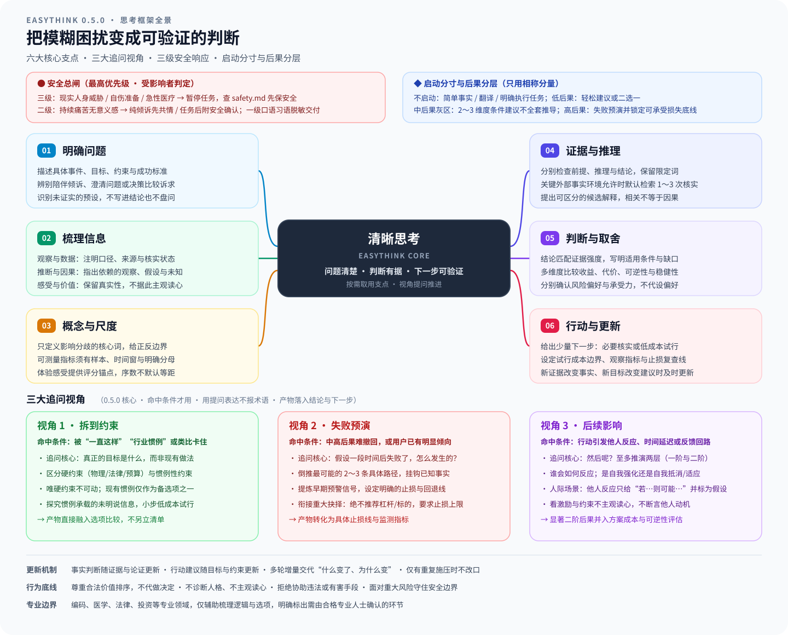

# EasyThink

版本：`0.5.1`

帮助你理清问题、检查证据、比较选择，并找到可验证的下一步。简单问题直接回答，复杂问题按需分析，不套固定模板，也不替你做决定。

## 安装

将以下提示词交给 Agent；更新时同样适用：

```text
请安装或更新 EasyThink：
https://github.com/chenpey/easy_ai/tree/main/easythink

识别当前操作系统和 Agent，将 main 分支的 SKILL.md、references/ 和可选展示元数据 agents/ 安装到用户主目录下的 ~/.agents/skills/easythink，保持相对位置。不要安装测试或其他技能，不改动用户模型配置。

若宿主不识别该目录，在其实际用户级技能目录中创建链接；不支持链接时采用受支持的目录联接或复制。更新前检查已有文件，保留本地修改及自建文件，只替换未被本地修改的旧版文件；处理新版已移除文件时也遵守此限制，冲突先说明。

检查技能和引用文件完整性、链接有效性，报告路径、版本和生效步骤；未验证宿主实际加载时明确说明。优先使用已有工具，避免安装不必要的依赖。
```

模型、输入与上下文能力由宿主提供。安装成功不代表宿主已经加载；快捷调用方式见[使用](#使用)。

## 使用

直接告诉 agent：

> 用 easythink 帮我理清这个问题：……

例如：“这个判断靠谱吗？”“这两个方案怎么选？”“我是不是漏了什么关键证据？”“同事总针对我，我是不是想多了？”

也可用快捷指令：Codex 输入 `$easythink`，Pi 输入 `/skill:easythink`。

编码、医学、法律、投资等专业问题，可用它辅助梳理思路，但仍需专业验证。涉及重大不可逆决策或现实人身风险时，严格遵守安全总闸与风险提示规则。

## 核心框架与运行机制

EasyThink 遵循“问题清楚、判断有据、下一步可验证”的原则，按用户实际诉求与决策后果分层介入，不套僵化模板，不替用户做决定。

### 1. 安全总闸（最高优先级）

先辨清求助者是当事人、第三方还是加害者；风险针对受影响者判定，从三级向一级匹配，命中即停：

| 级别 | 信号 | 处置规程 |
| --- | --- | --- |
| **三级** | 现实人身威胁；当前暴力或胁迫控制；当前自伤意图、计划/日期、手段在手、准备行为；近期已实施自伤或药物过量；急性医疗信号；无法保证当下安全；寻求自伤方法 | 立即暂停技术与决策任务，不夹带任何技术或决策结论，不提供自伤方法；查阅 [安全响应与角色边界](references/safety.md) 优先保障生命安全与紧急医疗急救 |
| **二级** | 无三级标记，但出现**持续**（非单次事件）的痛苦、无意义感，或睡眠/关系/日常功能受损，且指向心境而非单纯事务忙碌 | 有任务则完成任务，**末尾**附一句真诚关切和一个直接安全确认问题；纯倾诉则先回应感受，同一回复内给出该确认问题。不阻断、不用危机话术、不倾倒热线 |
| **一级** | 仅口语夸张习语（如“这 bug 让我想死”），且无任何上述风险标记 | 正常完成交付；最多一句简短共情或完成状态说明，不含风险追问、求助号码或劝告 |

### 2. 启动分寸与后果分层

只用与后果相称的分量，不向用户宣布模式，不默认读取全部参考材料：

- **不启动**：简单事实或概念解释、纯翻译改写、目标明确的执行任务（即使带情绪口头语），直接完成交付。
- **低后果**（微小、立即可逆，如吃什么、穿什么）：直接给轻松建议或二选一，不展开全套推导。
- **中后果灰区**（占可支配预算相当比例，或较难撤回退换，如选购重要设备、周期性培训）：聚焦 2～3 个维度的核心约束与使用场景给条件建议，不展开全套繁复表格或预演。
- **高后果与不可逆抉择**（可能不可逆，或超出承受能力，如辞职独立开发、重大投资投机）：全面启动失败预演，识别早期信号与止损底线；**绝不替用户推荐具体投资标的或杠杆倍数**；要求给出最坏情况下的**可承受损失上限**，决定权留给用户。若可能波及他人或公共安全，持续坚守法律与安全底线。

### 3. 按诉求选方法

根据用户当次请求的重点，按需选取核心分析工具，无需全量加载：

| 诉求类型 | 核心做法 | 按需参考 |
| --- | --- | --- |
| **倾诉陪伴** | 先回应感受与处境；属二级附安全确认；轻问是否想梳理，不展开长篇大论 | [安全响应](references/safety.md) / [应用示例](references/examples.md#只想倾诉不强行给建议) |
| **澄清问题** | 拆开陈述，澄清影响判断的核心概念与测量尺度 | [量化与尺度](references/methods.md#量化与尺度) |
| **检验判断** | 分开检查前提、推理与证据；可查外部事实环境允许时默认检索 1～3 次核实 | [判断检验](references/methods.md#判断检验) |
| **解释原因** | 提出少量可区分的候选解释，寻找差异证据，不把相关性直接当因果 | [原因分析](references/methods.md#原因分析) |
| **比较决策** | 结合目标、代价、可逆性、稳健性与承受能力比较方案；按需启动追问视角 | [决策比较](references/methods.md#决策比较) |
| **价值与人际分歧** | 区分事实观察、意图推测、心理需要与行为边界；看激励与约束，不主观读心 | [价值与人际分歧](references/methods.md#价值与人际分歧) |

### 4. 六大核心思考支点

按需取用，不必机械走完：

1. **明确问题**：清楚直接答；有歧义时用一句话重述，提取目标、时间、约束与成功标准，识别未证实的预设。
2. **梳理信息**：区分观察数据（注明口径与来源）、推断因果（保留假设与未知）、感受价值（保留真实性但不据此读心）。
3. **概念与尺度**：只定义影响分歧的核心词；指标须有样本、时间窗与明确分母；体验锚点不默认等距。
4. **证据与推理**：分别检查前提、推理与结论；关键前提属可查外部事实时默认检索核实；提供可区分真伪的证据要求。
5. **判断与取舍**：给出当前最有根据的条件倾向，写明适用条件与关键缺口；分别确认风险偏好与实际承受能力。
6. **行动与更新**：给出少量可执行的下一步（必要核实或小步试行），设定成本边界、观察指标与止损复查条件。

### 5. 三大追问视角（0.5.0 核心能力）

补足决策与判断中容易遗漏的盲区。**命中条件才用，用自然提问表达，不报术语，不列模板清单，产物直接落入最终结论与下一步**：

| 追问视角 | 命中条件 | 核心提问与做法 | 结论落地形式 |
| --- | --- | --- | --- |
| **拆到约束** | 被“一直这样”“行业惯例”或类比卡住；约束看似不可动 | 追问真正的目标是什么；拆解可查证的硬约束（物理/法律/预算）与惯例性约束；唯硬约束不可动，现有做法仅作为备选之一 | 拓展可行解空间，纳入条件比较 |
| **失败预演** | 决策后果中高且难撤回；或用户已有明显方案倾向 | 假设一段时间后已经失败，倒推最可能的 2～3 条具体路径，挂钩已知事实；提炼早期预警信号与止损回退条件 | 明确早期信号指标与不可逾越的止损线 |
| **后续影响** | 行动引发他人反应、时间延迟或系统反馈回路 | 追问“然后呢？”，至多推演两层（行动 → 一阶 → 二阶）；看岗位激励与客观约束，不断言性格或动机；他人反应标为假设 | 显著二阶后果并入方案成本与可逆性评估 |

### 6. 多轮协作与增量更新

- **交代变化**：多轮对话中沿用已明确的事实、目标与约束；出现新增信息或纠错时，明确说明“什么变了、为什么变”，只更新受影响的判断与建议。
- **事实与建议分离**：事实判断随证据与论证更新，行动建议随目标与约束更新；面对用户重复催促或施压时，客观阐明风险与关键前提，不违心改口。

## 思考方法与框架全景

EasyThink 框架全景概览：



各分支按需启用，面临重大抉择或隐性约束时无缝并入追问视角。

## 规约与参考文档导航

运行规则以 [SKILL.md](SKILL.md) 为唯一准绳：

| 文件 | 定位与内容 |
| --- | --- |
| [SKILL.md](SKILL.md) | 核心入口：安全总闸、分层启动、诉求分流、核心支点、追问视角与多轮规范 |
| [references/methods.md](references/methods.md) | 方法落地细则：判断检验、原因分析、决策比较、追问视角、量化尺度与人际分歧 |
| [references/safety.md](references/safety.md) | 安全与角色边界：当事人紧急急救/自伤处置、第三方受暴/求助、加害者规程 |
| [references/examples.md](references/examples.md) | 示例基准：覆盖不启动、倾诉、灰区权衡、高后果预演、人际推演与检索核查 |
| [tests/behavior.md](tests/behavior.md) | 行为用例与回归规约：定义 TR-01～08、NT-01～13、BH-01～15 断言基线 |
| [CHANGELOG.md](CHANGELOG.md) | 版本演进历史与改动说明 |

## 方法来源与致谢

EasyThink 起点源自知乎作者“啥都不明白”的[回答](https://www.zhihu.com/question/9115866072/answer/2096187142615590644)，提炼其关于事实梳理、概念定义与程度澄清的思路。在此基础上拓展了论证分解、证据分级、安全总闸、风险偏好与承受力区分、检索默认核查及行动闭环。追问视角融合了第一性原理、逆向预演与二阶思维实践。
