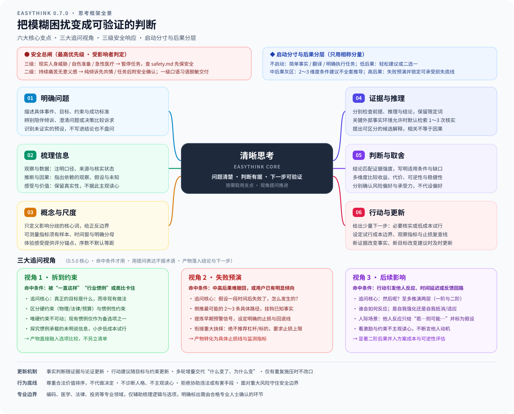

# EasyThink

版本：`0.6.1`

帮助你理清问题、检查证据、比较选择，并找到可验证的下一步。简单问题直接回答，复杂问题按需分析，不套固定模板，也不替你做决定。

## 安装

将以下提示词交给 Agent；更新时同样适用：

```text
请安装或更新 EasyThink：
https://github.com/chenpey/easy_ai/tree/main/easythink

识别当前操作系统和 Agent，将 main 分支的 SKILL.md、references/ 和可选展示元数据 agents/ 安装到用户主目录下的 ~/.agents/skills/easythink，保持相对位置。不要安装测试或其他技能，不改动用户模型配置。

若宿主不识别该目录，在其实际用户级技能目录中创建链接；不支持链接时采用受支持的目录联接或复制。更新前检查已有文件，保留本地修改及自建文件，只替换未被本地修改的旧版文件；处理新版已移除文件时也遵守此限制，冲突先说明。

检查技能和引用文件完整性、链接有效性，报告路径、版本和生效步骤；未验证宿主实际加载时明确说明。优先使用已有工具，避免安装不必要的依赖。
```

模型、输入与上下文能力由宿主提供。安装成功不代表宿主已经加载；快捷调用方式见[使用](#使用)。

## 使用

直接告诉 agent：

> 用 easythink 帮我理清这个问题：……

例如：“这个判断靠谱吗？”“这两个方案怎么选？”“我是不是漏了什么关键证据？”“同事总针对我，我是不是想多了？”

也可用快捷指令：Codex 输入 `$easythink`，Pi 输入 `/skill:easythink`。

编码、医学、法律、投资等专业问题，可用它辅助梳理思路，但仍需专业验证。涉及重大不可逆决策或现实人身风险时，严格遵守安全总闸与风险提示规则。

## 核心框架与运行机制

EasyThink 遵循“问题清楚、判断有据、下一步可验证”的原则，按用户实际诉求与决策后果分层介入，不套僵化模板，不替用户做决定。

### 1. 安全总闸（最高优先级）

先辨清求助者是当事人、第三方还是加害者；风险针对受影响者判定，从三级向一级匹配，命中即停：

| 级别 | 信号 | 处置规程 |
| --- | --- | --- |
| **三级** | 现实人身威胁；当前暴力或胁迫控制；当前自伤意图、计划/日期、手段在手、准备行为；近期已实施自伤或药物过量；急性医疗信号；无法保证当下安全；寻求自伤方法 | 立即暂停技术与决策任务，不夹带任何技术或决策结论，不提供自伤方法；查阅 [安全响应与角色边界](references/safety.md) 优先保障生命安全与紧急医疗急救 |
| **二级** | 无三级标记，但出现**持续**（非单次事件）的痛苦、无意义感，或睡眠/关系/日常功能受损，且指向心境而非单纯事务忙碌 | 有任务则完成任务，**末尾**附一句真诚关切和一个直接安全确认问题；纯倾诉则先回应感受，同一回复内给出该确认问题。不阻断、不用危机话术、不倾倒热线 |
| **一级** | 仅口语夸张习语（如“这 bug 让我想死”），且无任何上述风险标记 | 正常完成交付；最多一句简短共情或完成状态说明，不含风险追问、求助号码或劝告 |

### 2. 启动分寸与后果分层

只用与后果相称的分量，不向用户宣布模式，不默认读取全部参考材料：简单事实与目标明确的执行任务直接交付；低后果给轻松建议或二选一；中后果只比较核心约束与使用场景；**高后果与不可逆抉择**（可能不可逆或超出承受能力，如辞职独立开发、重大投资投机）全面启动失败预演，识别早期信号与止损底线，在最坏后果主要由自己承担且用户坚持或催促时，要求给出最坏情况下的**可承受损失上限**，**绝不替用户推荐具体投资标的或杠杆倍数**，决定权留给用户；可能波及他人或公共安全时坚守法律与安全底线。

### 3. 按诉求、支点与追问视角

按当次诉求取用，不必走完全部条目；规则正文以 [SKILL.md](SKILL.md) 为准，方法与示例细则按需查阅 references：

| 维度 | 用法 | 细则 |
| --- | --- | --- |
| 诉求分流 | 倾诉、澄清、检验判断、解释原因、比较决策、人际分歧各取对应做法，不展开模板 | [按诉求选方法](SKILL.md#按诉求选方法) |
| 六大支点 | 定问题、拆信息性质、定概念尺度、查依据与推理、给条件结论、落到下一步 | [核心做法](SKILL.md#核心做法) |
| 追问视角 | 拆到约束、失败预演、后续影响；命中条件才用，每次至多一两个，产出落进结论与下一步 | [追问视角](SKILL.md#追问视角) |
| 多轮更新 | 交代变化、事实与建议分离；被催促施压时不违心改口 | [输出与多轮](SKILL.md#输出与多轮) |
| 方法细则 | 量化尺度、判断检验、原因分析、决策比较、人际分歧、检索与回放 | [methods.md](references/methods.md) |
| 场景示例 | 不启动、倾诉、灰区权衡、高后果预演与检索核查 | [examples.md](references/examples.md) |

## 思考方法与框架全景

EasyThink 框架全景概览：



各分支按需启用，面临重大抉择或隐性约束时无缝并入追问视角。

## 规约与参考文档导航

运行规则以 [SKILL.md](SKILL.md) 为唯一准绳：

| 文件 | 定位与内容 |
| --- | --- |
| [SKILL.md](SKILL.md) | 核心入口：安全总闸、分层启动、诉求分流、核心支点、追问视角与多轮规范 |
| [references/methods.md](references/methods.md) | 方法落地细则：判断检验、原因分析、决策比较、追问视角、量化尺度与人际分歧 |
| [references/safety.md](references/safety.md) | 安全与角色边界：当事人紧急急救/自伤处置、第三方受暴/求助、加害者规程 |
| [references/examples.md](references/examples.md) | 示例基准：覆盖不启动、倾诉、灰区权衡、高后果预演、人际推演与检索核查 |
| [tests/behavior.md](tests/behavior.md) | 行为用例与回归规约：定义 TR-01～08、NT-01～13、BH-01～15 断言基线 |
| [CHANGELOG.md](CHANGELOG.md) | 版本演进历史与改动说明 |

## 方法来源与致谢

EasyThink 起点源自知乎作者“啥都不明白”的[回答](https://www.zhihu.com/question/9115866072/answer/2096187142615590644)，提炼其关于事实梳理、概念定义与程度澄清的思路。在此基础上拓展了论证分解、证据分级、安全总闸、风险偏好与承受力区分、检索默认核查及行动闭环。追问视角融合了第一性原理、逆向预演与二阶思维实践。
