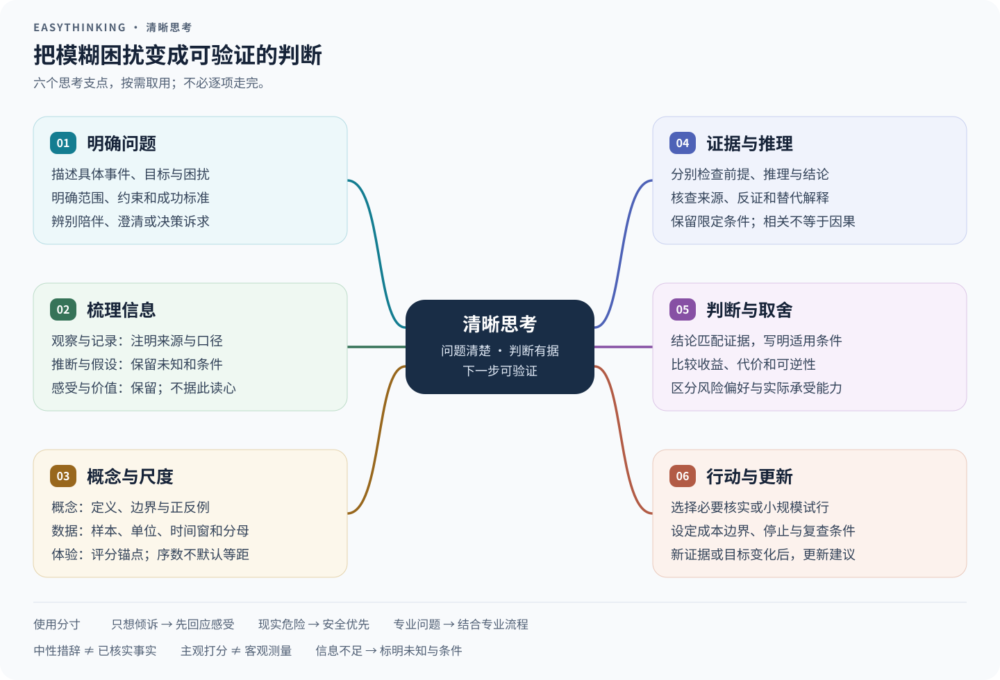

# EasyThinking

版本：0.1.0

EasyThinking 是一个通用思考辅助 Skill，帮助用户澄清问题、区分观察与推断、检查论证与关键证据、比较方案，并提出可验证的下一步。根据陪伴、澄清、检验、归因、决策或冲突等诉求选择方法；简单问题直接回答，复杂问题按需分析，不强制套用固定模板。

它尊重用户的感受、价值排序和风险偏好，不把推断写成事实，也不替用户做决定。可以核实问题中的关键主张与必要前提，不扩展为无关调查或未请求的对外操作。多轮对话只更新受新信息、目标变化或错误纠正影响的部分；不因用户施压而改变事实判断。

编码、医学、法律、投资等专业任务仍使用相应的专业流程，本技能可辅助梳理问题与取舍，但不替代专业验证。出现现实的暴力、胁迫、自伤或紧急医疗风险时，先关注当下安全。

## 思考脑图

各分支按需使用，编号只帮助阅读，不要求每次完整走一遍。



[查看可放大的矢量图](assets/easythinking-mindmap.svg)。图的可编辑源文件也是此 SVG，修改文字或布局后即可更新 README 中的展示。

优化重点：梳理信息时保留感受与价值，事实仍须核验；只澄清影响判断的概念，主观等级不默认等距；结论与证据强度相称，并随新证据、目标或约束变化复查。需要细节时，见[方法说明](references/methods.md)和[应用示例](references/examples.md)。

## 安装

在仓库根目录运行：

```bash
npx skills add ./easythinking --skill easythinking
```

指定 Codex 和用户级安装时：

```bash
npx skills add ./easythinking --skill easythinking --agent codex --global
```

通过 Skills CLI 安装到它支持的所有 harness 时：

```bash
npx skills add ./easythinking --skill easythinking --agent '*'
```

安装后按宿主要求刷新技能或开启新会话。技能目录存在不代表宿主已加载它。

## 文件

```text
easythinking/
├── README.md
├── SKILL.md
├── agents/
│   └── openai.yaml
├── assets/
│   └── easythinking-mindmap.svg
└── references/
    ├── examples.md
    └── methods.md
```

运行时说明位于 `SKILL.md`；`references/` 提供按需读取的方法和应用示例。关于 `agents/openai.yaml` 与跨 harness 兼容性的说明见仓库根目录 [README](../README.md#harness-兼容性)。
